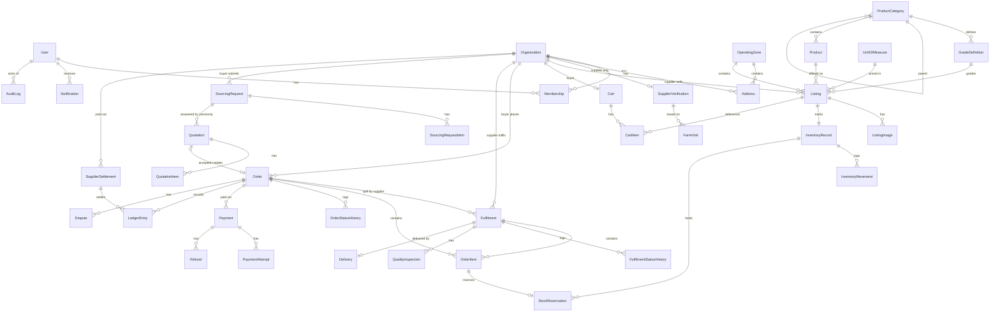

# DigiFarm — Architecture & Delivery Roadmap

Status: **v7 — Phases 1 (Foundation) and 2 (Marketplace) implemented, Phase 3 (Transactions) in progress; see §10–§12 for status and deviations**
Date: 2026-10-31

This document is the plan of record for building DigiFarm, a B2B agricultural sourcing marketplace and managed-fulfilment platform for Ghana. It covers the current state of the repository, the proposed architecture, the initial data model, the MVP scope, a phased plan with acceptance criteria, open business decisions, and the main risks.

Phase 1 is implemented (§10). Later phases are plans. Decisions are recorded in §7.

---

## 1. Existing codebase

The `digifarm` directory is **empty** and is **not a git repository**. There is no existing code, schema, configuration, or dependency to preserve.

Local tooling available on the development machine:

| Tool   | Version | Notes                                                |
| ------ | ------- | ---------------------------------------------------- |
| Node   | 22.x    | LTS — suitable for Next.js                            |
| pnpm   | 12.x    | Will be the package manager                           |
| Docker | 29.x    | Not used — development uses Neon branches (§10) |
| git    | 2.50    | Repo will be initialised in Phase 1, step 1           |
| psql   | —       | Not installed; not required (use Docker/Prisma Studio) |

A Neon (managed Postgres) integration is connected to this workspace; Neon is the chosen database host (D13).

---

## 2. Proposed architecture

### 2.1 Shape: a modular monolith

One Next.js application, delivered as an installable **Progressive Web App (PWA)** for phones and desktops, and one Postgres database, split internally into **domain modules with explicit boundaries**. Background jobs live in a Postgres-backed job table drained by scheduled Vercel Cron routes (same codebase). No microservices until real scaling evidence justifies extracting one.

```
                ┌──────────────────────── Next.js app (web) ────────────────────────┐
 Browser/PWA ─▶ │  app/ (routes, layouts, server components, server actions)        │
                │  service worker: app shell + static assets, offline page          │
                │        │  calls only public module APIs                            │
                │        ▼                                                           │
                │  modules/  identity · verification · catalog · inventory ·         │
                │            ordering · sourcing · payments · fulfilment ·           │
                │            notifications · reporting · audit                        │
                │        │                                                           │
                │  lib/      db · money · env · logger · errors · storage · authz    │
                └────────┼───────────────────────────────────────────────────────────┘
                         ▼
 Paystack/Hubtel ──▶ /api/webhooks/* ──▶ payments module ──▶ PostgreSQL (Neon) ◀── job runner /api/cron/*
                                                                │                   (Vercel Cron: reservation expiry,
                                         S3-compatible storage ◀┘                    notifications, reconciliation)
```

### 2.2 Technology choices

| Concern            | Choice                                                        | Why / notes |
| ------------------ | ------------------------------------------------------------- | ----------- |
| Framework          | Next.js (App Router), React, TypeScript `strict`              | As specified. Pin exact versions at bootstrap. |
| PWA                | Web app manifest (`app/manifest.ts`) + a small hand-written service worker (`public/sw.js`) — chosen over Serwist so the caching rules stay short and auditable | Installs to the home screen on Android and iPhone and opens full-screen. Caches the app shell and static assets for fast loads on slow networks, with a branded offline page. **All data is network-first** — prices, stock and orders are never served stale from cache, so there is no offline ordering. Verify the Serwist version against the Next.js version at bootstrap. |
| Styling / UI       | Tailwind CSS + shadcn/ui                                      | Components are copied into the repo, so they are owned and themed with the brand tokens in §2.5. Mobile-first layouts. |
| Database           | PostgreSQL 16+ on **Neon** (D13); a Neon branch per preview deployment | Row locking, `CHECK` constraints, partial indexes, transactional DDL. |
| ORM                | Prisma + migrations                                           | Raw SQL (`$queryRaw`/`$executeRaw`) only for atomic inventory updates and reporting, wrapped in the owning module. |
| Auth               | **Better Auth** (recommended) with Prisma adapter             | Email + password, email verification, password reset, DB-backed sessions, rate limiting, extensible to phone OTP later. Auth.js discourages credentials auth and makes verification flows awkward; Lucia is deprecated. Verify current version and security advisories at bootstrap. |
| Validation         | Zod at every boundary (forms, server actions, route handlers, env, webhooks) | Shared schemas between client form and server action. |
| Forms              | React Hook Form + Zod resolver                                |  |
| Client data        | TanStack Query only where it helps (cart, order status polling, admin tables) | Default to server components; avoid duplicating server state. |
| Background jobs    | **Postgres `Job` table + Vercel Cron** draining it via `/api/cron/*`; Next.js `after()` to kick work off right after a request | Vercel (D13) has no long-running worker, which rules out pg-boss. Jobs are enqueued in the same transaction as the business change, claimed with `FOR UPDATE SKIP LOCKED`, retried with backoff; handlers are idempotent. Cron frequency depends on the Vercel plan — verify before staging (daily-only cron is too coarse for reservation expiry). Handlers can later move to Inngest/QStash or a dedicated worker unchanged. |
| File storage       | S3-compatible (Cloudflare R2 or AWS S3); MinIO locally        | Two buckets: **public** (listing images, via CDN) and **private** (farm-visit photos, proof of delivery; presigned short-lived URLs only). |
| Email              | Provider interface; Resend/Postmark/SES adapter; Mailpit locally | Replaceable. |
| Payments           | Provider interface; **Paystack** adapter first (Hubtel as alternative) | Mobile money + cards. Capabilities, fees, settlement terms must be verified with the provider before go-live. |
| Logging            | pino, JSON, with redaction paths (passwords, tokens, auth headers, signatures) |  |
| Errors / APM       | Sentry (or equivalent)                                        |  |
| Unit/integration tests | Vitest; integration tests run against a real Postgres (Docker) | Concurrency/overselling tests must hit real Postgres, not mocks. |
| E2E                | Playwright with desktop, mobile Chrome and mobile WebKit (iPhone) profiles | Critical flows only. Real-device checks per §2.6. |
| CI                 | GitHub Actions: typecheck, lint, unit+integration tests, build, migration check |  |

### 2.3 Repository layout

```
digifarm/
├─ prisma/                 schema.prisma, migrations/, seed.ts
├─ public/sw.js            service worker: app shell + static assets only, offline page
├─ src/
│  ├─ app/
│  │  ├─ manifest.ts       web app manifest (name, icons, theme colours from the brand)
│  │  ├─ icons/[variant]/  PWA + Apple touch icons, generated at build time from the brand mark
│  │  ├─ offline/          offline fallback page
│  │  ├─ (marketing)/      landing, about
│  │  ├─ (auth)/           sign-in, sign-up, verify-email, reset-password, onboarding
│  │  ├─ market/           catalogue, product detail, supplier profiles (public, SEO)
│  │  ├─ buyer/            dashboard, cart, checkout, orders, sourcing requests, settings
│  │  ├─ admin/            ops console: managed suppliers, farm visits, listings & stock,
│  │  │                    orders, fulfilment, sourcing, payments, audit
│  │  ├─ supplier/         (deferred, D6) self-service portal
│  │  └─ api/              webhooks/paystack, cron/*, health, auth/[...]
│  ├─ modules/<module>/
│  │  ├─ index.ts          public API (the only import surface for other code)
│  │  ├─ service.ts        use cases — take an Actor, enforce policy, run transactions
│  │  ├─ policy.ts         authorization rules
│  │  ├─ schemas.ts        Zod input schemas
│  │  ├─ state-machine.ts  (where relevant) allowed transitions
│  │  └─ *.test.ts
│  ├─ lib/                 db, env, money, quantity, logger, errors, storage, authz, audit
│  └─ components/          ui/ (shadcn), shared composites (DataTable, StatusBadge, MoneyText…)
├─ e2e/                    Playwright specs (desktop, mobile Chrome, mobile WebKit)
├─ vercel.json             cron schedules for the /api/cron/* job runners
└─ docs/                   ROADMAP.md, ADRs, runbooks, brand/
```

Boundary rules (enforced with ESLint `no-restricted-imports`):

- `app/` may import `modules/*/index.ts`, `components/`, `lib/` — **never Prisma directly**.
- A module may import another module only through its `index.ts`.
- Business logic never lives in React components.

### 2.4 Cross-cutting design rules

**Authorization.** Every service function receives an `Actor` (`userId`, platform role, active organization + org role). Two layers:
1. *Policy check* — `assertCan(actor, "order.cancel", order)`.
2. *Scoped queries* — tenant data is always fetched with `WHERE organizationId = actor.orgId` (or via an explicit admin path). This is the primary IDOR defence: an ID from the URL is never trusted on its own.

UI hiding is cosmetic only. Layout-level guards redirect, but the service layer is the enforcement point.

**Roles.**
- Platform roles on `User`: `USER`, `OPS` (operations staff), `ADMIN`, `DELIVERY_PARTNER` (reserved, inactive in MVP).
- Organization roles on `Membership`: `OWNER`, `MANAGER`, `MEMBER` — lets a hotel or cooperative have several staff accounts.
- **Managed suppliers (D6):** a supplier organization can exist with no user accounts. OPS staff act on its behalf — editing listings, recording stock, confirming orders — and every such action is audited with the staff member as actor and the supplier org as `onBehalfOfOrgId`.
- Admins are created by a seed/CLI command, never through the UI. No user can elevate their own role or approve their own verification.

**Money.** Integer **minor units (pesewas)** stored as `BigInt`, always paired with an explicit `currency` column (`GHS`). A `Money` value object handles arithmetic, formatting, and JSON serialisation. No floats anywhere in the money path.

**Quantities.** `Decimal(14,3)` (e.g. 2.5 tonnes). Line total = `round_half_up(quantity × unitPriceMinor)` computed with decimal arithmetic, once, at order creation, and stored.

**Units of measure.** Units have a `kind`: `MASS` (kg, tonne), `COUNT` (piece), `CONTAINER` (bag, crate, basket), `BUNDLE` (bunch, tuber heap). Only same-kind *universal* conversions are automatic (kg ↔ tonne). A "bag" is **not** convertible to kg globally — a listing may optionally declare `netWeightPerUnitKg` (e.g. "50 kg bag of maize"), which is informational and used for logistics weight estimates, never for silent price conversion.

**Snapshots.** Order items copy product name, variety, grade, unit, unit price, supplier name, and listing ID at order time. Delivery addresses are snapshotted onto the order. Later edits never change historical orders.

**State machines.** `Order`, `Fulfilment`, `Delivery`, `SourcingRequest`, `Quotation`, `Payment`, `Dispute`, and `SupplierVerification` each have an explicit transition table in code. Every change goes through `transition(entity, to, actor, reason)`, which validates the transition, writes a status-history row, writes an audit log entry, and enqueues notifications — in one DB transaction.

**Inventory concurrency.** Reservation is a single conditional update:

```sql
UPDATE "InventoryRecord"
   SET reserved = reserved + $qty, version = version + 1
 WHERE "listingId" = $id AND (on_hand - reserved) >= $qty
RETURNING *;
```

Zero rows affected ⇒ insufficient stock ⇒ the whole checkout transaction rolls back. Multi-line carts lock inventory rows in a consistent order (by `listingId`) to avoid deadlocks. Every change also writes an `InventoryMovement` row. DB `CHECK (reserved >= 0 AND reserved <= on_hand)` is the last line of defence.

**Stock accuracy (D1/D6).** DigiFarm manages every farm's stock, so the stock in the app is the truth: if it shows, it can be bought; if not, the listing shows "Out of stock". Each listing stores `stockConfirmedAt`/`stockConfirmedById` (when stock was last updated, and by whom). Listings not updated for 72 hours appear on a staff reminder list; buyers are unaffected.

**Idempotency.** Checkout and payment initiation accept an idempotency key (unique constraint). Webhooks are deduplicated by `(provider, providerEventId)` unique constraint and processed inside a transaction; a payment is only marked `SUCCEEDED` after **server-side verification with the provider's API**, never on the webhook body or redirect alone.

**Transactional outbox.** Notifications and other side effects are written as rows/jobs in the same transaction as the business change, then delivered by the worker with retries. No "order saved but email lost" or "email sent but order rolled back".

**Audit & immutability.** `AuditLog` and `LedgerEntry` are append-only: the app DB role gets `INSERT`/`SELECT` only on those tables (enforced by a migration with `REVOKE UPDATE, DELETE`). Corrections are new reversing entries, never edits.

**Deletion & retention.** Soft-delete (`deletedAt`) for listings, addresses, and organizations. Financial records, orders, and audit logs are never hard-deleted; retention period to be set with an accountant/lawyer ([D11](#7-business-decisions)). Account closure anonymises personal fields while keeping financial records intact.

### 2.5 Brand & design system

Source of truth: [`docs/brand/primary-logo.pdf`](brand/primary-logo.pdf) (DigiFarm brand mark sheet). The UI is built from this sheet, not from a generic palette.

**Logo.** A "D" mark (square left edge, rounded right) in Field Green with a white leaf cut-out and a Harvest Gold square "pixel" at the top-right, next to the wordmark **Digi** (Soil) **Farm** (Field Green) and the tagline `FARM TO BUYER · GHANA` in spaced monospace caps. Variants on the sheet:

| Variant | Use in the product |
| --- | --- |
| Primary lockup (mark + wordmark + tagline) | Landing hero, emails, invoices/PDFs |
| Mark + wordmark, no tagline | App headers and navigation |
| On dark (Sprout mark, white "Digi", Sprout "Farm" on Soil) | Dark footer, dark admin sidebar, splash |
| One colour (all Soil) | Single-colour print, delivery notes, receipts |
| App icon (white D + leaf on Field Green rounded square, gold pixel) | Favicon, PWA install icons (192/512 px + maskable), Apple touch icon, iOS splash screens, social avatar |

The supplied PDF is a **raster image** (no vector paths). For Phase 1 the mark will be redrawn as an SVG `<Logo variant=… />` component matching the sheet; the designer's original SVG/AI export should replace it when available ([D15](#7-business-decisions)).

**Colour tokens** (from the sheet, with derived tints for UI states):

| Token | Hex | Role | Contrast notes |
| --- | --- | --- | --- |
| `field-green` | `#17663A` | Primary: buttons, links, active nav, verified badges | 7.0:1 on white — AA/AAA for text |
| `soil` | `#13261A` | Body text, headings, dark surfaces | ~16:1 on white |
| `sprout` | `#8FD16A` | Accent on dark surfaces; success highlights; chart series | ~2:1 on white — **never text on light backgrounds**; ~8:1 on Soil |
| `harvest-gold` | `#F2A900` | Highlights: "new", pending/attention badges (with Soil text), focus accents, logo pixel | ~2:1 on white — **never text on light backgrounds**; use as fill with Soil text |
| `paper` | `#F6F6F1` (approx., sheet background) | App background / warm neutral | — |
| `white` | `#FFFFFF` | Cards, tables, inputs | — |

Derived neutrals (borders, muted text) and semantic colours (error red, info) will be generated to sit with this palette and checked for WCAG AA; status badges never rely on colour alone (text label + icon).

**Typography** (inferred from the sheet — confirm with the designer, D15):
- Display / wordmark style: a geometric grotesque in bold (closest open-source match: **Space Grotesk**).
- Labels, order numbers, SKUs, tagline-style eyebrows: monospace caps with wide tracking (closest match: **Space Mono**).
- Body and dense tables: a highly legible UI sans (**Inter**) for readability at small sizes on low-end Android screens.

**Character.** Matches the sheet: flat colour, generous white space, soft 16–24px card radius, thin hairline borders, no gradients or drop-shadow-heavy cards, restrained motion.

Tokens are defined once as CSS variables and mapped into Tailwind; fonts load with `next/font`. The PWA's `theme_color` is Field Green and its `background_color` is Paper, so the installed app's status bar and launch screen match the brand.

### 2.6 Testing on simulators and phones

The PWA must be checked on the iOS Simulator, the Android Emulator and real phones at every phase exit — not only in a desktop browser.

| Target | How | Notes |
| --- | --- | --- |
| **iOS Simulator** (Xcode — already installed on this Mac) | Open `http://localhost:3000` in the simulator's Safari → Share → **Add to Home Screen** | The simulator uses the Mac's network, so `localhost` counts as a secure origin and the service worker works without HTTPS. Debug with desktop Safari → Develop → Simulator. |
| **Android Emulator** (Android Studio — not installed yet) | `adb reverse tcp:3000 tcp:3000`, then open `http://localhost:3000` in the emulator's Chrome → **Install app** | `adb reverse` makes the dev server `localhost` inside the emulator. Using `10.0.2.2` loads pages, but install and service worker won't work. Debug via `chrome://inspect`. |
| **Android phone over USB** | Turn on USB debugging, `adb reverse tcp:3000 tcp:3000`, open `localhost:3000` in Chrome | Full PWA behaviour plus remote debugging from the Mac. |
| **Any phone on the same Wi-Fi** | `pnpm dev:lan`, open `http://<Mac IP>:3000` | Quick layout checks only — over plain HTTP a real phone won't register the service worker or install the app. |
| **Any phone, full PWA** (iPhone included) | `pnpm dev:tunnel` (Cloudflare Tunnel → temporary HTTPS link) or a Vercel preview URL | HTTPS is required to install and go offline on a real device. iPhone: Safari → Share → Add to Home Screen. Android: Chrome → Install app. |
| **Automated** | Playwright with Pixel (Chromium) and iPhone (WebKit) profiles in CI; Lighthouse installability checks | Emulated viewports catch layout regressions but don't replace a real-device pass. |

Install, offline and update behaviour are tested against a production build (`pnpm build && pnpm start`), because the service worker is switched off in `next dev` to avoid stale-cache confusion while developing.

---

## 3. Initial database schema

### 3.1 Entity evaluation

Entities from the brief, and what happens to each in the MVP:

| Brief entity | MVP decision |
| --- | --- |
| User, Account, Session, Verification | **Keep** — owned by the auth library's Prisma adapter. |
| BusinessProfile / BuyerProfile / SupplierProfile | **Merged into `Organization`** (with `type: BUYER \| SUPPLIER`) + small type-specific columns. Avoids three 1:1 tables and supports multi-user businesses via `Membership`. |
| SupplierVerification | **Keep, reshaped as farm-visit verification (D7).** DigiFarm staff visit farms and record a `FarmVisit` (date, staff, GPS, photos, notes, produce seen, recommended grade). Approval must be by a different staff member than the visitor. No supplier-uploaded ID documents in MVP, so no Ghana Card data is stored. |
| Address | **Keep**. Ghana-specific: region, district, town, landmark, optional GhanaPost GPS digital address, optional lat/lng. |
| Product, ProductCategory | **Keep**. `Product` is the canonical item (e.g. "Tomato — Pectomech"); `Listing` is a supplier's offer of it. |
| *new:* GradeDefinition | **Add (D8)** — DigiFarm A/B/C grades per category, with description and reference photos. |
| *new:* OperatingZone | **Add (D4)** — `ACCRA`, `KUMASI`; addresses and listings belong to a zone; delivery only to serviced zones. |
| ProductListing | **Keep** as `Listing`, plus `ListingImage`. |
| InventoryRecord, InventoryMovement | **Keep**, plus `StockReservation`. |
| UnitOfMeasure | **Keep** (seeded reference table with `kind` and `factorToBase`). |
| Order, OrderItem, OrderStatusHistory | **Keep**. |
| Fulfilment | **Keep** — one per **(order, supplier)**. This is how multi-supplier orders work: an order splits into fulfilments, each with its own confirmation, inspection, delivery, and settlement. |
| Quotation, QuotationItem | **Keep**, plus `SourcingRequest` + `SourcingRequestItem` (the buyer's request that a quotation answers). |
| Payment, PaymentAttempt | **Keep**, plus `ProviderEvent` (webhook dedupe log). |
| Refund | **Keep**. |
| PlatformFee | **Folded into `LedgerEntry`** (type `COMMISSION`, D2) with the commission rate snapshotted on `Fulfilment`. A separate table would duplicate ledger data. |
| SupplierSettlement | **Keep** — records payouts (manual in MVP) and links to ledger entries. |
| Delivery | **Keep** — one per fulfilment in MVP. |
| DeliveryAssignment | **Deferred.** `Delivery.assigneeUserId` + carrier fields cover MVP; a full assignment table arrives with the delivery-partner role. |
| QualityInspection | **Keep** (optional per fulfilment; required for managed orders). |
| Dispute | **Keep** (simple; message thread deferred — notes field + audit log). |
| Review | **Phase 4** (after disputes exist; needs completed-order gating). |
| Notification | **Keep** — doubles as outbox and in-app notification feed. |
| AuditLog | **Keep**. |
| *new:* LedgerEntry | **Add** — append-only financial journal (captures, fees, supplier payables, payouts, refunds, delivery fees). Reconciliation and reporting read from here. |
| *new:* Cart, CartItem | **Add** — server-side cart so it survives devices and can be re-validated. |

### 3.2 Entity-relationship diagram



### 3.3 Key tables (MVP fields, abbreviated)

| Table | Key columns | Constraints / indexes |
| --- | --- | --- |
| `User` | id, email, emailVerified, name, phone, platformRole, status | unique(email) |
| `Organization` | id, type, legalName, tradingName, phone, region, district, status (`PENDING`, `ACTIVE`, `SUSPENDED`), buyerSegment (restaurant/hotel/…), supplierKind (farmer/cooperative/aggregator/vendor), deletedAt | index(type, status) |
| `Membership` | userId, organizationId, role | unique(userId, organizationId) |
| `Address` | orgId, zoneId, label, region, district, town, street, landmark, digitalAddress, lat, lng, isDefault | index(orgId) |
| `SupplierVerification` | orgId, status (`PROSPECT`→`VISITED`→`APPROVED`/`REJECTED`, `SUSPENDED`), approvedById, approvedAt, notes | unique(orgId); approver ≠ the staff member who did the visit (checked in service) |
| `FarmVisit` | verificationId, visitedById, visitedAt, lat, lng, photoKeys[] (private bucket), produceObserved, recommendedGradeId, notes | index(verificationId) |
| `OperatingZone` | code (`ACCRA`, `KUMASI`), name, isActive | unique(code) |
| `GradeDefinition` | categoryId, code (`A`/`B`/`C`), description, photoKeys[] | unique(categoryId, code) |
| `ProductCategory` | id, parentId, slug, name | unique(slug) |
| `Product` | categoryId, name, variety, slug | unique(slug) |
| `UnitOfMeasure` | code (`KG`, `TONNE`, `BAG`, `CRATE`, `BUNCH`…), kind, factorToBase (nullable) | unique(code) |
| `Listing` | supplierOrgId, productId, unitId, gradeId, zoneId, unitPriceMinor, currency, minOrderQty, stockConfirmedAt, stockConfirmedById, netWeightPerUnitKg?, harvestDate?, availableFrom, availableUntil?, pickupAddressId, status (`DRAFT`, `ACTIVE`, `PAUSED`, `ARCHIVED`), deletedAt | index(status, productId), index(supplierOrgId), GIN/trigram on product name for search |
| `InventoryRecord` | listingId, onHand, reserved, version | unique(listingId); CHECK(reserved ≥ 0 AND reserved ≤ onHand) |
| `InventoryMovement` | inventoryId, type (`ADJUST`, `RESERVE`, `RELEASE`, `COMMIT`, `RETURN`), qty, refType, refId, actorId, createdAt | index(inventoryId, createdAt) |
| `StockReservation` | inventoryId, orderItemId, qty, status (`ACTIVE`, `COMMITTED`, `RELEASED`), expiresAt | index(status, expiresAt) for expiry sweeper |
| `Order` | number (human-readable, e.g. `DF-2026-000123`), buyerOrgId, channel (`MARKETPLACE`, `MANAGED`), status, currency, subtotalMinor, deliveryFeeMinor, totalMinor, deliveryAddressSnapshot (JSON), requestedDeliveryDate, quotationId?, idempotencyKey | unique(number), unique(idempotencyKey), index(buyerOrgId, createdAt), index(status) |
| `Fulfilment` | orderId, supplierOrgId, status, commissionBps (snapshot), confirmedAt, confirmedById (ops), shortageNotes | unique(orderId, supplierOrgId), index(supplierOrgId, status) |
| `OrderItem` | orderId, fulfilmentId, listingId?, productNameSnapshot, varietySnapshot, gradeSnapshot, unitCodeSnapshot, qtyOrdered, qtyConfirmed?, qtyDelivered?, unitPriceMinor, lineTotalMinor | |
| `SourcingRequest` | buyerOrgId, status, deliveryAddressSnapshot, deadline, budgetMinor?, notes | |
| `Quotation` | sourcingRequestId, version, status (`DRAFT`, `SENT`, `ACCEPTED`, `REJECTED`, `EXPIRED`, `SUPERSEDED`), validUntil, subtotal/delivery/total minor | unique(sourcingRequestId, version) |
| `QuotationItem` | quotationId, supplierOrgId, productId, snapshots, qty, unitPriceMinor, lineTotalMinor | |
| `Payment` | orderId, provider, amountMinor, currency, status (`PENDING`, `SUCCEEDED`, `FAILED`, `ABANDONED`, `REFUNDED`, `PARTIALLY_REFUNDED`) | index(orderId) |
| `PaymentAttempt` | paymentId, providerReference, channel (momo/card), status, rawStatus, verifiedAt | unique(provider, providerReference) |
| `ProviderEvent` | provider, providerEventId, type, payloadHash, receivedAt, processedAt, error | unique(provider, providerEventId) |
| `Refund` | paymentId, amountMinor, reason, status, providerReference, requestedById, approvedById | |
| `LedgerEntry` | type, amountMinor (signed), currency, orderId?, fulfilmentId?, supplierOrgId?, paymentId?, settlementId?, createdAt, memo | append-only; index(supplierOrgId, type) |
| `SupplierSettlement` | supplierOrgId, amountMinor, status (`PENDING`, `PAID`, `FAILED`), method, externalReference, paidAt, recordedById | |
| `Delivery` | fulfilmentId, status, carrierName, assigneeUserId?, pickupWindow, deliveryWindow, feeMinor, proofStorageKey?, receivedByName?, failureReason? | unique(fulfilmentId) |
| `QualityInspection` | fulfilmentId, inspectorId, stage (`PICKUP`, `DELIVERY`), result (`PASS`, `PARTIAL`, `FAIL`), notes, photoKeys[] | |
| `Dispute` | orderId, fulfilmentId?, raisedByOrgId, type (`MISSING`, `DAMAGED`, `WRONG_ITEM`, `QUALITY`, `OTHER`), status, resolution, refundId? | |
| `Notification` | userId, channel, template, payload, status, attempts, sentAt, readAt | index(status) for outbox, index(userId, readAt) |
| `AuditLog` | actorUserId?, actorRole, action, entityType, entityId, before (JSON), after (JSON), ip, userAgent, createdAt | append-only; index(entityType, entityId) |

### 3.4 Core state machines

**Order (marketplace channel)**

```
PENDING_PAYMENT ──pay verified──▶ PAID ──all fulfilments confirmed──▶ IN_FULFILMENT
      │                            │                                       │
      ├─timeout──▶ EXPIRED         ├─all suppliers reject──▶ CANCELLED     ├─all delivered──▶ DELIVERED ──buyer confirms / auto after N days──▶ COMPLETED
      └─buyer──▶ CANCELLED         └─(refund issued)                       └─partial──▶ PARTIALLY_DELIVERED ─▶ DELIVERED/COMPLETED
```

Any of `DELIVERED`/`PARTIALLY_DELIVERED`/`COMPLETED` (within a dispute window) can have an open `Dispute` attached; disputes don't replace the order status, they gate settlement.

**Fulfilment (per supplier)**
`AWAITING_SUPPLIER → CONFIRMED | PARTIALLY_CONFIRMED | REJECTED → READY_FOR_PICKUP → PICKED_UP → DELIVERED | FAILED_DELIVERY (→ RESCHEDULED → PICKED_UP)`

**Reservation lifecycle**
Created at checkout (`ACTIVE`, expires in N minutes) → `COMMITTED` when payment is verified (decrements `onHand`) → `RELEASED` on expiry, cancellation, or supplier rejection.

D1 (stock shown is DigiFarm-managed, so payment confirms the order) and D3 (prepaid only) are reflected above. Because DigiFarm's stock is the truth, a fulfilment starts as confirmed; the `PARTIALLY_CONFIRMED`/`REJECTED` paths are kept only for the exception where produce isn't there at pickup, which refunds the affected items. Delivery states are provisional until D5 is decided.

---

## 4. Recommended MVP scope (controlled pilot)

Goal: a real operator can run a **single-region pilot** end-to-end — onboarding, listings, ordering, payment, fulfilment, delivery, settlement — without editing the database by hand.

**In scope**
- Email/password auth with email verification, password reset, DB sessions, rate limiting.
- Buyer and supplier organizations, multi-user membership, addresses.
- **Ops-managed suppliers (D6/D7):** DigiFarm staff recruit farms, record farm visits (photos, GPS, notes, recommended grade) and approve suppliers. Staff run supplier profiles, listings and stock on the farmer's behalf after confirming availability by phone. Only approved suppliers' listings are visible.
- Two operating zones from day one: Greater Accra and Kumasi (D4).
- **Installable PWA (D16/D17)**: the same app installs to the home screen on Android and iPhone, opens full-screen with the DigiFarm icon, loads quickly on slow networks and shows a clear offline screen. Buyer and admin flows are designed phone-first; farm-visit photos and GPS use the phone's camera and location through the browser. Tested on the iOS Simulator, Android Emulator and real phones (§2.6).
- Catalogue: categories, canonical products, supplier listings with images, grade, unit, MOQ, harvest/availability dates; search, filters, pagination; supplier profile pages with verified badges.
- Inventory: stock adjustments, reservations with expiry, movements log, concurrency-safe checkout.
- Cart and checkout for single- and multi-supplier orders; order splitting into fulfilments.
- Order lifecycle with enforced state machines and status history; buyer cancel within allowed states; reorder.
- Managed sourcing: buyer request → ops builds quotation (versioned) → buyer accepts/rejects → accepted quote creates order.
- Paystack integration (mobile money + card) behind a provider interface: initialize, redirect/callback, server-side verify, signed idempotent webhooks, abandoned-payment handling, refunds (admin-approved).
- Ledger recording payment captures, supplier commission (D2 — the only revenue line in the MVP), refunds and supplier payables. Payout method and cadence are pending (D9).
- Fulfilment ops console: pickup from farms, shortages found at pickup (refunded per D10), quality inspection records, delivery recording and status updates (delivery model pending D5), proof-of-delivery photo + receiver name, failed delivery/reschedule.
- Disputes for missing/damaged/wrong produce with admin resolution (refund or credit note record).
- Email notifications via outbox: verification, order placed/confirmed/rejected, payment result, quotation sent/expiring, delivery updates, cancellation/refund.
- Admin dashboard: GMV, completed orders, platform revenue, AOV, fulfilment rate, on-time rate, cancellation/dispute rates, verification queue; audit log viewer.
- Production deployment, migrations, backups, Sentry, structured logs, runbooks.

**Explicitly out of MVP (designed for, not built)**
- App Store / Play Store listings (a Google Play listing is possible later by wrapping the PWA as a Trusted Web Activity) and Web Push notifications (Phase 5 at the earliest; email is the MVP channel).
- Supplier logins and a self-service supplier portal (DigiFarm manages suppliers — D6; roles and schema already support it).
- Delivery-partner app/role (schema reserves it; ops update status on their behalf).
- SMS / WhatsApp notifications and phone OTP login (provider not yet selected).
- Escrow, automatic split payments, automated supplier payouts.
- Credit/net-terms invoicing with automated collections (unless D3 says otherwise).
- Real-time GPS tracking (status-based tracking only — UI must not imply live location).
- Ratings & reviews (lands in Phase 4 after disputes).
- Profit / contribution margin reporting beyond the cost data actually recorded.
- Multi-language UI (copy kept in one place to make i18n easy later).
- Native mobile apps (responsive web, tuned for low-bandwidth Android).

---

## 5. Phased implementation plan

Sizing: **S** ≈ days, **M** ≈ ~1 week, **L** ≈ 2+ weeks of focused work for one engineer. These are relative estimates, not commitments.

### Phase 1 — Foundation (L)

Each step is a small, reviewable, tested increment.

| # | Step | Acceptance criteria |
| --- | --- | --- |
| 1.1 | **Bootstrap**: git init, Next.js + TS strict, pnpm, ESLint (+ boundary rules), Prettier, Tailwind, shadcn/ui, Vitest, Playwright (desktop + mobile Chrome + mobile WebKit), `docker-compose.yml` (Postgres, Mailpit, MinIO), `dev:lan` and `dev:tunnel` scripts, GitHub Actions CI | `pnpm dev` runs; the site opens on the iOS Simulator and on your phone; `pnpm typecheck lint test build` pass locally and in CI; `.env.example` documented |
| 1.2 | **Core libs**: Zod-validated `env`, pino logger with redaction, typed error classes, `Money` + `Quantity` helpers, Prisma client singleton, `Actor` context, `audit()` helper | Unit tests for Money rounding/serialisation and env failure on missing vars; logger redacts secrets (test) |
| 1.3 | **Schema slice 1**: auth tables, User, Organization, Membership, Address, OperatingZone, SupplierVerification, FarmVisit, AuditLog (+ REVOKE UPDATE/DELETE migration) | `prisma migrate dev` from empty DB works; append-only enforced (integration test: UPDATE on AuditLog fails) |
| 1.4 | **Authentication**: Better Auth, sign-up/in/out, email verification, password reset, secure cookies, rate limits on auth endpoints, Mailpit in dev | E2E: sign up → receive email in Mailpit → verify → sign in; unverified users blocked from protected areas; brute-force rate limit test; the session survives closing and reopening the installed PWA |
| 1.5 | **Buyer onboarding**: sign up → create buyer Organization + OWNER membership → business details → delivery addresses in a serviced zone (Accra/Kumasi) | Integration tests: one active org per user in MVP; addresses outside serviced zones rejected; cannot join/modify another org by ID tampering |
| 1.6 | **RBAC**: policy module, route-group guards (`buyer/`, `admin/`), service-level `assertCan`, ops on-behalf-of-supplier actions, admin/ops seed command | Permission matrix tests (each role × each protected action); direct server-action calls without permission return 403 |
| 1.7 | **Managed suppliers & farm visits**: ops create supplier orgs (no login needed), record farm visits with photos (private bucket: MIME sniffing, size limits, presigned URLs), approve/reject/suspend, audit | Tests: a visitor cannot approve their own visit; buyers cannot see suppliers' private data or visit photos; every decision has an audit row |
| 1.8 | **Design system & shells**: brand tokens from §2.5 (Field Green, Soil, Sprout, Harvest Gold, Paper; WCAG AA), SVG `<Logo>` with all five sheet variants, favicon/app icon, base components, `StatusBadge`, `MoneyText`, `DataTable`, empty/loading/error states, role-specific app shells, mobile nav | Lighthouse accessibility ≥ 95 on shells; components render all states in a dev showcase page |
| 1.9 | **Landing + profile/settings pages** | Responsive at 360px; no auth-only data on public pages |
| 1.10 | **PWA**: manifest (name, brand colours, icons incl. maskable), Serwist service worker (app shell + static assets, offline page, "new version — reload" prompt), iOS meta tags and splash screens, Android install prompt, an "Install DigiFarm" help page for iPhone users | Lighthouse installability checks pass; installs and opens full-screen on the iOS Simulator, the Android Emulator and a real phone; offline shows the branded page; no price, stock or order data is ever served from cache (test) |

**Phase 1 exit:** a buyer can register, verify email and onboard in Accra or Kumasi, in a desktop browser and as an installed PWA on a phone; ops can create a supplier and record a farm visit, and a second staff member can approve it; all of it is authorized server-side, audited, and covered by tests.

### Phase 2 — Marketplace (M–L)
- Seed categories, canonical products, units (labelled seed data, not fake suppliers).
- Listing CRUD by ops on behalf of approved suppliers, with image upload (resize/WebP), A/B/C grade, unit, MOQ, price, availability dates, pickup location and zone.
- Grade definitions per category (A/B/C with reference photos), managed by admins.
- Stock update quick action for staff; a reminder list for listings not updated in 3 days.
- Inventory record per listing, stock adjustments with movement log.
- Public catalogue: search (Postgres full-text + trigram), filters (category, region/district, price range, grade, availability, MOQ), cursor pagination, product detail, supplier profile + verified badge.
- Admin listing moderation (pause/archive with reason).
- Phone-first catalogue: bottom-sheet filters, thumb-reachable actions, responsive WebP images sized for slow connections; checked on the simulators and a real phone.
- **Exit:** a buyer can find and compare real listings; unverified suppliers cannot publish; listing changes are logged.

### Phase 3 — Transactions (L)
- **Before starting:** cancellation/refund/dispute policy drafted for review (D10). **Before live payments:** D11, D12, D14 resolved; until then Paystack runs in test mode only.
- Server-side cart; checkout re-validates price/availability/MOQ; order split into fulfilments; reservations with expiry job.
- **Concurrency test suite**: N parallel checkouts against the last units ⇒ exactly the available quantity sold, never more.
- Order state machine + history + buyer cancellation + reorder.
- Payment provider interface + Paystack adapter: initialize, verify, webhook (signature, dedupe, transactional), abandoned-payment expiry, refunds. Sandbox only until live credentials are provided.
- Ledger entries on capture, fee, refund; reconciliation report (provider transactions vs internal payments) as a scheduled job + admin view.
- Managed sourcing: request form, ops quotation builder (versioned, validity window), buyer accept/reject, accepted quote ⇒ order.
- Paystack checkout tested inside the **installed** PWA on iPhone and Android, including the return to DigiFarm after payment (installed PWAs handle external redirects differently from a browser tab).
- **Exit:** a buyer can pay with Paystack test mode for a multi-supplier order; payment is only marked successful after verification; duplicate webhooks are no-ops; oversell is impossible under concurrent load.

### Phase 4 — Fulfilment (L)
- **Before starting:** D5 (delivery model) and D9 (farmer payouts) decided.
- Shortage handling: when produce isn't there at pickup, staff record it and the affected items are refunded; reservations released.
- Ops fulfilment console: pickup scheduling, carrier/rider assignment, delivery windows and fees, status updates, failed delivery + reschedule.
- Quality inspections (pickup/delivery), shortage handling and partial refunds.
- Proof of delivery (photo + receiver name); buyer receipt confirmation; auto-complete after N days.
- Disputes workflow; settlement holds while a dispute is open.
- Supplier settlements: payable balances from ledger, admin records each payout with an external reference (method and cadence per D9).
- Notification service hardening (templates, retries, preferences). Ratings & reviews on completed fulfilments.
- Photo capture from the phone camera for proof of delivery, disputes and farm visits, with images compressed in the browser before upload.
- **Exit:** an order can go from paid to completed with a full, auditable trail, including partial delivery and a resolved dispute.

### Phase 5 — Administration & launch (M–L)
- Admin dashboard and reports (GMV vs platform revenue clearly separated; profit only where costs are recorded), CSV export.
- Supplier performance and buyer activity views; demand by location.
- Security review (OWASP checklist, authz matrix re-run, dependency audit, secrets scan, upload hardening, CSP headers).
- Playwright suites for the critical paths; load test checkout/inventory and webhook handling with realistic pilot volumes.
- Production infrastructure: environments (dev/staging/prod), migrations in CI/CD, automated backups + **tested restore**, Sentry, uptime checks, log retention.
- PWA hardening: Web Push notifications (Android; iPhone only when installed, iOS 16.4+), service-worker update flow, optional Google Play listing via Trusted Web Activity, real-device pass on a low-end Android phone.
- Runbooks: payment incident, webhook backlog, stuck reservations, restore from backup, rotating secrets. Launch checklist.
- **Exit:** Definition of Done in the brief is met and signed off for a controlled pilot.

---

## 6. Integrations requiring credentials or configuration

| Integration | Needed by | What's needed from you |
| --- | --- | --- |
| Neon (Postgres) | Phase 1 staging | Neon project and region (EU region nearest Ghana, matched to the Vercel function region) |
| Email provider | Phase 1 staging | Provider account, verified sending domain (SPF/DKIM/DMARC) |
| S3-compatible storage | Phase 1 staging | Bucket provider + credentials (public + private buckets) |
| Paystack (or Hubtel) | Phase 3 | Business account, **test** keys first; live keys only at launch after KYC/compliance |
| Sentry | Phase 1/5 | Project DSN |
| Android Studio (Android Emulator + `adb`) | Phase 1 | Free install on your Mac; not installed yet. Xcode and iPhone simulators are already installed |
| Cloudflare Tunnel (`cloudflared`) or ngrok | Phase 1 | Free tool for an HTTPS link to test the full PWA on your phone; not installed yet |
| Vercel + domain | Phase 1 staging | Vercel project (the plan determines cron frequency), domain name |
| SMS/WhatsApp | Post-MVP | Provider selection (e.g. Hubtel, Arkesel, mNotify, WhatsApp Business) and sender ID registration |

No keys will be fabricated. Until credentials exist, adapters run against local fakes that are clearly labelled as such in code and UI.

---

## 7. Business decisions

Recorded 2026-10-27 with the founder.

| # | Decision | Status | Answer and consequence |
| --- | --- | --- | --- |
| **D1** | Checkout order | **Decided (revised 2026-10-31)** | DigiFarm manages every farm's stock and keeps it up to date in the app. Stock shown is available: the buyer pays and the order is confirmed straight away, with no farm-confirmation step after payment. Anything not available shows as out of stock and can't be bought. |
| **D2** | Revenue model | **Decided** | Supplier commission only (basis points, snapshotted per fulfilment). No buyer service fee in the MVP. Managed-sourcing quotations show product cost and delivery; commission is deducted on the supplier side. |
| **D3** | Credit terms | **Decided** | Prepaid only in the MVP. |
| **D4** | Pilot geography | **Decided** | Greater Accra and Kumasi from the start, modelled as two operating zones. Open sub-question: are cross-zone orders allowed (e.g. Kumasi farm → Accra buyer)? Default until D5: yes for managed sourcing, same-zone only for marketplace orders. |
| **D5** | Delivery model | **Deferred** | Needed before Phase 4. The delivery schema stays minimal and provider-agnostic until then. |
| **D6** | Supplier onboarding | **Decided** | DigiFarm manages suppliers. Staff phone farmers to check availability and update listings and stock in the app. Supplier logins and a self-service portal are deferred. |
| **D7** | Supplier verification | **Decided** | DigiFarm recruits farms through site visits. Verification = a recorded farm visit plus approval by a second staff member. No supplier ID-document uploads in the MVP. |
| **D8** | Grading | **Decided** | DigiFarm A/B/C grades per category, with descriptions and reference photos, assigned by staff. |
| **D9** | Farmer payouts | **Deferred** | Needed before Phase 4. The ledger tracks supplier payables from Phase 3 regardless. |
| **D10** | Cancellation/refund/dispute policy | **Draft v2 in use (2026-10-31) — six questions still open** | Draft: [`docs/policies/cancellations-refunds-disputes.md`](policies/cancellations-refunds-disputes.md). Phase 3 was started with the draft's proposals as defaults (30-minute hold, free cancellation until pickup, full refunds). The numbers live in `src/modules/ordering/config.ts`, so the answers to its §6 change configuration, not code. |
| **D11** | Tax & invoicing | **Deferred** | Must be resolved with an accountant before live payments. Invoices are designed so tax lines can be added. |
| **D12** | Handling customer funds (Act 987) | **Deferred** | Must be resolved before live payments. The MVP collects through a licensed provider and makes no escrow claims. |
| **D13** | Hosting | **Decided** | Vercel (web) + Neon (Postgres). Background jobs run from a Postgres job table drained by Vercel Cron (§2.2). Regions to be matched. |
| **D14** | Data protection (Act 843) | **Deferred** | Must be resolved before real user data is collected in production. PII stays minimal regardless; the farm-visit model avoids storing ID numbers. |
| **D15** | Brand source files | **Pending: files coming** | Designer to send the SVG/AI logo and font names. The redrawn SVG and Space Grotesk / Space Mono / Inter are used until then. |
| **D16** | Client app | **Decided** | One Next.js app delivered as an installable **PWA** — no Expo or native app. Must be testable on the iOS Simulator, the Android Emulator and real phones (§2.6). |
| **D17** | Phone-first priorities | **Decided** | Buyer and admin flows are designed phone-first. Every role can use the PWA on a phone, including farm-visit capture. |

**Gates:** Phase 3 starts with the D10 draft · live payments need D11, D12, D14 · Phase 4 needs D5 and D9.

---

## 8. Main risks

### Technical

| Risk | Mitigation |
| --- | --- |
| Overselling under concurrent checkout | Atomic conditional updates, DB CHECK constraints, ordered locking, real-Postgres concurrency tests |
| Mobile-money payments are asynchronous (USSD prompt approvals, timeouts, late webhooks) | Treat `PENDING` as first-class; verify server-side; reconcile on a schedule; reservation expiry longer than typical MoMo approval time; late success after expiry triggers re-reserve or automatic refund |
| Duplicate/forged webhooks | Signature validation, unique event IDs, transactional processing, always re-verify via provider API |
| IDOR / broken access control in a multi-tenant app | Actor-scoped queries, policy layer, permission-matrix tests, no Prisma in UI code |
| Background jobs lost or run twice | Postgres job table with retries and `SKIP LOCKED` claiming; every handler idempotent; outbox pattern |
| Floating-point or rounding errors in money | Integer pesewas, single rounding rule, unit tests on every calculation |
| Vercel has no long-running worker; cron frequency is plan-limited | Postgres job table drained by Vercel Cron + `after()`; idempotent handlers; move to Inngest/QStash or a worker if volume demands |
| Low bandwidth / older Android devices | Server components, small JS bundles, responsive WebP images, minimal client libraries, test on throttled 3G |
| Scope creep slowing the pilot | Hold to the MVP list; new requests go to the post-MVP backlog |
| iPhone PWA limits: no install prompt (users must use Share → Add to Home Screen), push only when installed (iOS 16.4+), site storage can be cleared | Treat installation as an extra, not a requirement; "Install DigiFarm" guide for iPhone; email as the baseline notification channel; never depend on cached data |
| Service-worker cache shows stale prices or stock | Network-first for all data; cache only the app shell and static assets; versioned service worker with a reload prompt; automated test that data requests bypass the cache |
| Payment redirects inside an installed PWA | Test Paystack on real iPhone and Android installs in Phase 3; fall back to opening checkout in the browser if the return trip fails |

### Operational & business

| Risk | Mitigation |
| --- | --- |
| Marketplace cold start (buyers without supply, suppliers without demand) | Managed sourcing as the wedge; ops-assisted supplier onboarding; focus on one region and a few categories |
| Perishability and quality variance → disputes | Grade definitions with photos, quality inspection records, clear dispute policy, fast resolution SLAs |
| Stock in the app drifts from what farms actually have | DigiFarm staff update stock whenever a farm's situation changes; staff reminder list for listings not updated in 3 days; shortages at pickup recorded against the farm (3 in 30 days triggers review); affected items refunded per D10 |
| Ops team becomes the bottleneck — every stock update and confirmation goes through staff phone calls (D6) | Fast ops tooling (bulk stock confirmation, daily call lists per zone), SLA metrics on confirmation time, supplier self-service once suppliers are ready |
| Logistics cost erodes margin | Zone-based delivery fees, minimum order values, consolidation of pickups; record actual costs so contribution margin is measurable |
| Supplier payout delays damage trust | Visible payable balances, predictable payout schedule (D9) |
| Fraudulent suppliers or buyers | Verification before listing, payment before dispatch (D1/D3), audit logs, admin suspension tools |
| Regulatory exposure (funds handling, data protection, tax) | Decisions D11, D12, D14 resolved with professional advice before live payments |
| Single point of failure in ops knowledge | Runbooks, admin tools for every workflow, no manual DB edits |

---

## 9. Next step

Decisions are recorded in §7, and Phase 1 has no open blockers. Implementation begins with **Phase 1, step 1.1 — repository bootstrap**, followed by each subsequent step with tests, type checks, lint and build run and reported at every increment.

---

## 10. Phase 1 status (2026-10-27)

**Done — all steps 1.1–1.10, verified by automated tests and on the iOS Simulator.**

| Step | What exists | Verified by |
| --- | --- | --- |
| 1.1 Bootstrap | Next.js 16.4 (App Router, Turbopack, Cache Components), TS strict, Tailwind 4, shadcn/ui, ESLint boundary rules, Prettier, Vitest, Playwright, GitHub Actions CI | `pnpm typecheck lint test build` |
| 1.2 Core libs | Zod env (with `APP_ENV` guard), pino with redaction, typed errors, `Money` (pesewas, bigint), `Quantity`, audit helper, `parseInput` | unit tests |
| 1.3 Schema | Auth tables, User (platform roles), Organization, Membership, Address, OperatingZone (Accra, Kumasi seeded), SupplierVerification, FarmVisit, FarmVisitPhoto, AuditLog; append-only trigger on `audit_log` | integration test: UPDATE/DELETE on audit rows fails |
| 1.4 Auth | Better Auth 1.7.13: email + password, required email verification, password reset, DB-backed rate limits, secure cookies, 5-minute session cookie cache | E2E + API checks (role escalation at sign-up ignored; unverified sign-in refused) |
| 1.5 Buyer onboarding | Business, owner membership, delivery address in a serviced zone; one business per user even under simultaneous submits | integration + E2E on desktop, Pixel, iPhone (WebKit) |
| 1.6 RBAC | `can()` permission matrix, actor-scoped queries, page guards, proxy redirect, staff created only by `pnpm admin:create` | 120+ matrix tests, IDOR test, access E2E |
| 1.7 Managed suppliers | Staff create suppliers (no login), record farm visits with camera photos + GPS, approve/reject/suspend/reinstate; approver ≠ visitor; photos content-checked and served only to staff | integration tests, manual run in browser |
| 1.8 Design system | Brand tokens, SVG logo (5 variants), 44px touch targets, app shells (phone tab bar, desktop sidebar), status badges | visual checks at 320/375 px and on the iPhone simulator |
| 1.9 Pages | Landing, sign-in/up, verify email, forgot/reset password, buyer home and addresses, staff overview and suppliers, install guide | E2E |
| 1.10 PWA | Manifest, generated icons (incl. maskable + Apple), service worker (app shell only), offline page, "new version — reload" prompt | PWA E2E; installed on the iOS Simulator home screen and opened full-screen |

**Deviations from the plan above, and why**
- **No Docker.** Local development uses the Neon project `digifarm` (London, `aws-eu-west-2`): branch `dev` for the app and branch `test` for integration tests. `main` is reserved for production.
- **Email and file storage are development adapters.** Emails print to the dev server log and are saved to `.storage/outbox/`; photos go to `.storage/private/`. Both are refused when `APP_ENV` is `staging` or `production`, so real providers must be chosen before staging (§6).
- **Hand-written service worker instead of Serwist** (see §2.2).
- **iOS splash screens not added yet** — iOS shows the Paper background colour while launching. Add once the designer's vector logo arrives (D15).
- **Supplier self-service pages** (`src/app/supplier/`) not built, as decided in D6.

**Known limitations / follow-ups**
- Local pages take 1–5 s because each database query travels to London (~120 ms round trip). In production the app runs next to the database. Prisma's `relationJoins` preview feature would cut round trips further; not enabled while it is a preview.
- Sign-out on other devices can lag up to 5 minutes (session cookie cache); suspensions apply immediately.
- Android Emulator and a tunnel tool (`cloudflared`) are not installed yet, so Android and real-phone checks (§2.6) are still to do.
- Nothing is deployed yet: Vercel project, real email provider, S3-compatible storage and Sentry need accounts (§6).

---

## 11. Phase 2 status (2026-10-31)

**Done — a buyer can find and compare real listings; unapproved suppliers can't sell; every listing change is logged.**

| Item | What exists | Verified by |
| --- | --- | --- |
| Reference data | 8 units (kg, tonne, bag, crate, basket, bunch, piece, tuber), 6 categories, 32 products, A/B/C grade wording per category. Seed data only — no fake farms or prices | `pnpm db:seed` (idempotent; never overwrites grade wording an admin edited) |
| Listings | Staff create listings for approved suppliers only: product, unit, A/B/C grade, zone, price (pesewas), minimum order, weight per unit, harvest and availability dates, notes, opening stock. Draft → on sale → paused → archived, with a required reason to pause or archive | integration tests (approval gate, transitions, suspension removes listings from the market) |
| Photos | Up to 6 per listing; resized to 480 px and 1200 px WebP, camera rotation applied, all metadata (including GPS) removed; served from `/media/listings/…` with long-lived caching | integration test checks EXIF is gone; manual upload in the browser |
| Stock | One stock record per listing; "Confirm stock" after phoning the farmer sets the count and refreshes the confirmation time; append-only movement history; stock can't drop below what's held for orders | integration tests (DB trigger blocks edits to history) |
| Stock reminders | Stock entered by staff stays orderable until it runs out. Listings not updated in 72 hours appear on the staff overview and the "Not updated in 3 days" list as a reminder; buyers are unaffected (revised 2026-10-31, D1) | integration test |
| Grades | Staff read and admins edit the A/B/C wording per category; every edit audited | integration test (ops refused) |
| Public market | `/market` (no sign-in needed): search, category chips, bottom-sheet filters (zone, grade, price range, in stock only, sort), cursor paging; listing page with other farms selling the same product; farm profile with verified badge. Never shows a farmer's phone number or exact location | integration + E2E on iPhone (WebKit) and Pixel profiles |
| Audit | `listing.created/updated/stock_confirmed/publish/pause/resume/archive/photos_added/photo_removed`, `grade.updated`, each with before/after values and the supplier as `onBehalfOfOrgId` | integration tests |

**Deviations from the plan above, and why**
- **Old stock isn't hidden from buyers** (revised 2026-10-31). DigiFarm manages stock, so whatever staff entered stays orderable; a listing not updated in 3 days only appears on a staff reminder list.
- **Search uses case-insensitive matching on product, variety and category names** (served by the trigram index), not full-text ranking. Enough for a 32-product catalogue; revisit when the catalogue grows.
- **Grade reference photos are not built yet.** Grades have names and descriptions only; photos follow once DigiFarm has real examples per category.
- **Product photos use the local storage driver**, like farm-visit photos (§10). An S3-compatible driver is needed before staging.
- **Ordering wasn't open in Phase 2.** It opened with Phase 3 (§12).

**Known limitations / follow-ups**
- Staff pages take a few seconds locally because the development database is in London (see §10).
- The "in stock only" filter can return a short page when stock is held for orders, because reservations are checked after the query. Phase 3 now creates holds, so this can happen; fix by filtering on `onHand - reserved` in SQL when it matters.

---

## 12. Phase 3 status (2026-10-31)

**In progress — a buyer can order from several farms, pay (test stand-in or Paystack test mode) and cancel for a refund; overselling is impossible under concurrent checkouts.** Managed sourcing and the installed-PWA payment check are still to do.

| Item | What exists | Verified by |
| --- | --- | --- |
| Schema | Cart, CartItem, Order (numbers `DF-2026-000123` from a sequence), Fulfilment (one per farm, commission snapshot), OrderItem (snapshots), OrderStatusHistory, StockReservation, Payment, PaymentAttempt, ProviderEvent, Refund, LedgerEntry; CHECK constraints on amounts and quantities; ledger append-only by trigger | migrations; integration test (ledger UPDATE/DELETE refused) |
| Cart | Server-side, one per buyer business; minimum order and stock checked on add; re-priced on every view; lines that stop being sold are flagged | integration tests |
| Checkout | Re-checks price, stock, minimum order, dates and delivery area in one transaction; holds stock with a conditional update in listing order; all-or-nothing; idempotency key; same-zone orders only (D4) | integration tests, incl. **12 simultaneous checkouts on 25 crates ⇒ exactly 5 orders, 25 held** |
| Holds | 30 minutes (`PAYMENT_HOLD_MINUTES`); expired holds released at the start of every checkout on the same listings and by `/api/cron/expire-orders`; before expiring, the provider is asked once more | integration tests (expire, last-moment payment) |
| Order states | `PENDING_PAYMENT → PAID` (paid = confirmed, D1) / `EXPIRED` / `CANCELLED`; history row + audit for every change; Phase 4 states defined | unit + integration tests |
| Payments | Provider interface; Paystack adapter (initialize, verify, refund, list, HMAC-SHA512 webhook signature); development stand-in with a clearly labelled `/dev/pay` page. An order is paid only after DigiFarm asks the provider; amount or currency mismatches are never confirmed; late or duplicate payments are refunded automatically | unit tests (adapter with mocked HTTP), integration tests |
| Webhook | `/api/webhooks/paystack`: signature first, deduplicated by `(provider, eventId)`, 500 so Paystack retries on failure | integration test (unsigned refused, duplicate is a no-op) |
| Cancellation | Before payment: hold released. Paid, nothing picked up: stock returned (logged), farm share reversed in the ledger, full refund. Afterwards: refused | integration tests, browser |
| Refunds | Sent to the provider straight away; if unreachable they stay pending with the reason, show on the staff overview, and staff can send again | integration tests |
| Ledger | Payment received, provider fee, owed to farm, commission, delivery fee, refunds; reversals for cancellations | integration tests |
| Reconciliation | Provider vs DigiFarm successful payments per day: admin page `/admin/payments` and daily `/api/cron/reconcile-payments` | browser |
| Screens | Buyer: add to cart on the product page, cart, checkout, order list and detail (pay countdown, cancel, order again). Staff: orders list/detail with ledger and refunds. Confirmation email (development transport) | browser (desktop), E2E access checks |

**Deviations from the plan above, and why**
- **Holds don't write stock-history rows.** A hold only changes `reserved`; the history records changes to stock on hand (sold, returned), so it isn't flooded by unpaid checkouts. `StockReservation` is the log of holds.
- **No job table yet.** Expiry runs at checkout and from a cron route; reconciliation from a cron route. `vercel.json` schedules are added once the Vercel plan is known (Hobby allows daily cron only). Both routes need `CRON_SECRET`.
- **Commission is 0% and delivery is free** until the rate (D2) and delivery model (D5) are set: `COMMISSION_BPS` and `DELIVERY_FEE_MINOR` in `src/modules/ordering/config.ts`.
- **Notifications are a direct email after payment**, not the outbox described in §2.4. The outbox comes with the notification work in Phase 4.

**Still to do in Phase 3**
- Managed sourcing (request form, quotation builder, accept ⇒ order).
- Paystack test keys from the founder (§6), then a test-mode run including the webhook, and checkout inside the **installed** PWA on iPhone and Android.
- Paystack field names for refund webhooks are from documentation and need confirming against a test-mode refund.

